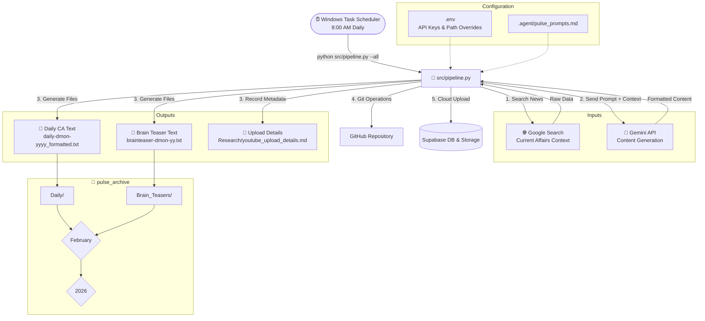

# Pulse Vector

**Pulse Vector** is an intelligent, automated data pipeline and content creation engine for YouTube. It combines our **Daily/Weekly/Monthly Current Affairs** content with our daily **Mahabharat Animated Shorts** series, automatically sorting, compiling, and uploading content into a structured, date-based hierarchy.

---

## 🎯 Channel Positioning & Brand Identity

* **Channel Name**: Pulse Vector
* **Channel Tagline**: *"Where Ancient History meets Modern Knowledge"*
* **Channel Bio / About**:
  > "Pulse Vector — Where Ancient History meets Modern Knowledge. Master the epic history of the Mahabharat through high-quality 9:16 animated shorts, and stay ahead with concise Daily, Weekly & Monthly Current Affairs for exams and general awareness."

---

## 📺 YouTube Upload & Engagement Strategy

* **Category**: **Education** (Category ID `27`).
* **Related Video Setting**:
  * **Daily Current Affairs Shorts (9:16)**: Linked to the latest **Weekly Current Affairs Masterclass** (or previous Daily episode).
  * **Weekly / Monthly Videos**: Linked to **Pulse Vector Channel Homepage** & **Current Affairs Playlist**.
* **Standard Pinned Comment**:
  ```text
  🧠 Master your exam prep with daily 60-second Current Affairs updates! 
  📚 Watch our full Weekly Masterclass: [Link]
  🔔 Subscribe to Pulse Vector & turn on notifications so you never miss a day!
  Which question should we feature in tomorrow's quiz? Drop it below! 👇
  ```
* **Community Tab Engagement Calendar**:
  * **8:00 AM IST**: Daily Current Affairs Quiz Poll (4 options for UPSC/SSC/Govt exams).
  * **1:00 PM IST**: Daily Top 5 Headlines Summary Infographic.

---

## 🚀 Key Features

*   **Automated Content Generation**: Fetches news context and automatically generates Current Affairs summaries and Brain Teasers using the Gemini API. This includes **Daily summaries** (15 points), **Weekly summaries** (30 points on Sundays), and **Monthly summaries** (50 points on the last day of each month).
*   **Dynamic 30 FPS Video Transitions**: Smoothly compiles 9:16 vertical glassmorphism slides with dynamic visual motion (`slide_left`, `zoom_fade`, `fade`) across Daily, Weekly, and Monthly videos.
*   **Automated Video Compilation & Upload**: Automatically compiles videos from generated slides (Daily: 3 slides, Weekly: 6 slides, Monthly: 10 slides), completes them with a dynamically-generated thumbnail/cover image, animated subscriber call-to-actions, and background music, uploads them to YouTube, and places them into dedicated playlists (quarterly playlists for Daily, and annual playlists for Weekly/Monthly).
*   **Metadata & Strategy Tracking**: Automatically maintains `Research/youtube_upload_details.md` with title, category, related video settings, and pinned comment statuses.
*   **Intelligent Sorting**: Instantly organizes raw incoming files (from `incoming_data/`) into a clean `Year > Month > Category` structure.
*   **Git Automation**: Automatically commits and pushes new archived content to your GitHub repository.
*   **Cloud Database Backup**: Automatically integrates with Supabase to safely upload and log generated media (videos/images) without consuming local or GitHub Actions storage limits.
*   **Animated YouTube Outro Engine**: Features 5 broadcast-quality animated YouTube End Credit archetypes (Vox, MrBeast, Think School, Kurzgesagt, Veritasium) with animated Like/Share/Subscribe triads, dynamic parameters, and random rotation to prevent viewer fatigue.
*   **Single-Script Entrypoint**: Run the entire pipeline (including text generation, slide rendering, video compilation, YouTube upload, Git sync, and database backups) using a single command-line interface.

---

## 🤖 System Architecture & Workflow

The pipeline operates as a unified flow, executing sequentially or by specific stages:



### Component Details
1. **Pipeline Orchestrator (`src/pipeline.py`)**: The central script that handles content generation, local archiving/sorting, Git commit/push, and backups.
2. **System Prompts (`.agent/pulse_prompts.md`)**: Defines the AI persona and layout rules for the generated Current Affairs and Brain Teasers.
3. **Upload Details (`Research/youtube_upload_details.md`)**: Standardized tracking file for YouTube video metadata, category (Education), related video settings, and pinned comments.
4. **Structured Archive (`pulse_archive/`)**: A date-based folder tree keeping generated output categorized and clean.
5. **Supabase Integration (`src/core/database_utils.py`)**: Safely stores your large media files in a cloud bucket (`pulse-vector-media`) and logs pipeline metadata to avoid GitHub artifacts storage limits.

---

## 📂 Project Structure

```text
pulse-vector/
├── .agent/
│   ├── pulse_prompts.md          # AI prompts for Current Affairs & Brain Teasers
│   └── workflows/
│       └── pulse_daily.md        # Workflow description & channel strategy
├── incoming_data/                # [INPUT] Drop your raw .txt and .png files here
├── pulse_archive/                # [OUTPUT] The system organizes files here
│   └── 2026/
│       └── January/
│           ├── Daily/
│           ├── Weekly/
│           ├── Monthly/
│           └── Brain_Teasers/
├── Research/                     # Architecture docs, logs & strategy tracking
│   ├── ENHANCEMENTS_ROADMAP.md   # Feature roadmap
│   ├── PIPELINE_ARCHITECTURE.md  # System pipeline architecture
│   ├── youtube_upload_details.md # YouTube upload metadata & strategy tracking log
│   └── developer_token_usage.md  # Token consumption log
├── samples/                      # Media assets and sample templates
│   ├── Audio/                    # Royalty-free background audio tracks
│   └── Videos/                   # Compiled sample MP4 videos
├── credentials/                  # Secure credentials (ignored by Git)
│   ├── client_secrets.json       # OAuth client secrets
│   └── token.json                # User auth token
├── src/                          # Core Python automation scripts
├── .env                          # API Keys and environment variables
├── .gitignore                    # Git ignore list
├── requirements.txt              # Python dependencies
└── Readme.md                     # You are here
```

---

## 🛠️ Prerequisites

*   **Python 3.x** installed and added to your system PATH.
*   **Dependencies**: Install required packages using:
    ```bash
    pip install -r requirements.txt
    ```

---

## ⚙️ How to Use

### Configuration

You can customize directory paths by setting environment variables in your `.env` file:
*   `GEMINI_API_KEY`: Your Google Gemini API Key.
*   `PULSE_ARCHIVE_DIR`: Target path for archive (default: `pulse_archive`).
*   `PULSE_INPUT_DIR`: Folder for incoming manual files (default: `incoming_data`).
*   `PULSE_BACKUP_DIR`: Target path for copying backups (default: `G:\PulseVectorBackups\pulse_archive`).

### Running the Script

`src/pipeline.py` provides flags to run the pipeline selectively or all at once:

```bash
# Run the entire pipeline (Generate -> Archive -> Git Push -> Backup)
python src/pipeline.py --all

# Generate content for missing days only
python src/pipeline.py --generate

# Process and sort files dropped manually in incoming_data/
python src/pipeline.py --archive

# Run git status, add, commit, and push automatically
python src/pipeline.py --git

# Sync archive to backup location
python src/pipeline.py --backup

# List available Gemini models
python src/pipeline.py --list-models

# Run the Weekly Current Affairs POC (content + slides + video + YouTube upload)
python src/pipeline.py --weekly-poc

# Run the Monthly Current Affairs POC (content + slides + video + YouTube upload)
python src/pipeline.py --monthly-poc
```

---

## ⏰ Automated Scheduler Setup

To run the pipeline automatically every day at 8:00 AM on Windows, register a scheduled task. Run this command in **PowerShell (as Administrator)**:

```powershell
$Action = New-ScheduledTaskAction -Execute "e:\hdd-data\pulse-vector\scripts\run_daily.bat" -WorkingDirectory "e:\hdd-data\pulse-vector"
$Trigger = New-ScheduledTaskTrigger -Daily -At "8:15 AM"
$Settings = New-ScheduledTaskSettingsSet -StartWhenAvailable -AllowStartIfOnBatteries -DontStopIfGoingOnBatteries -WakeToRun
Register-ScheduledTask -TaskName "PulseVectorDaily" -Action $Action -Trigger $Trigger -Settings $Settings -Force
```

---

## 📄 File Formatting Rules (For Manual Archiving)

If you manually drop files into the `incoming_data` directory to be sorted via `python src/pipeline.py --archive`, follow these naming formats:

### 1. Current Affairs (Text Files)
Ensure the **first line** of your text file matches one of these formats:

| Category | Supported Title Formats (in first line) | Example |
| :--- | :--- | :--- |
| **Daily** | `Daily Current Affairs <Day> <Month> <Year>` | `Daily Current Affairs 31 January 2026` |
| | `Daily Current Affairs <DD><Mon><YYYY>` | `Daily Current Affairs 10Dec2025` |
| **Weekly** | `Weekly Current Affairs ( <Start> - <End> )` | `Weekly Current Affairs ( 20-Oct-2026 - 26-Oct-2026 )` |
| **Monthly** | `Monthly Current Affairs - (<Month>, <Year>)` | `Monthly Current Affairs - (November, 2026)` |

### 2. Brain Teasers (Images)
Name your image files (`.png`) using this format:
*   **Format**: `brainteaser-<DD><mon><YY>.png`
*   **Example**: `brainteaser-10jan26.png`
*   **Example**: `sample-brain-teaser-05feb26.png`

---
*Maintained by the Pulse Vector Team*