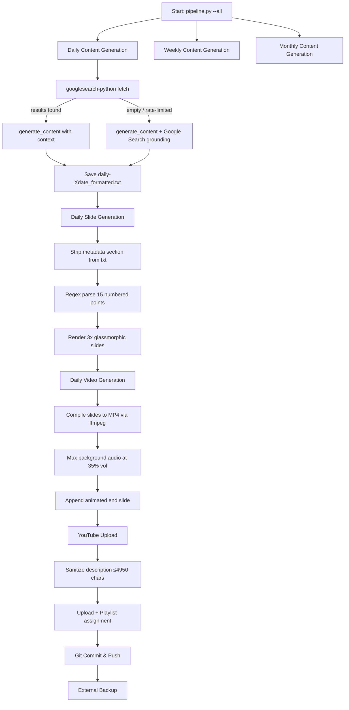

# Pulse Vector Automation Pipeline Architecture

This document outlines the system architecture, directory layouts, tech stack, and models powering the automated content generation and archiving pipeline for **Pulse Vector**.

---

## 🛠️ Tech Stack & Dependencies
*   **Core Logic**: Python 3.10+
*   **LLM API Integration**: `google-genai` (Gemini API v2.5 SDK) — with native Google Search grounding fallback
*   **Graphics & Render Engine**: Pillow (PIL)
*   **Search Integration**: `googlesearch-python` (with Gemini grounding auto-fallback)
*   **Video Compilation**: `opencv-python`, `ffmpeg` (subprocess)
*   **Audio**: `mutagen` (MP3 duration), `edge-tts` (TTS voiceover — POC, integration pending)
*   **YouTube Upload**: `google-api-python-client`, `google-auth-oauthlib`
*   **Environment Configuration**: `python-dotenv`
*   **Email Notifications**: Python `smtplib` + `MIMEMultipart`

---

## 🤖 Models & Configurations
*   **Generative Model**: `gemini-2.5-flash` (primary) → `gemini-2.0-flash` → `gemini-1.5-flash` (fallback chain)
*   **Search Strategy**: `googlesearch-python` (primary) → Gemini native Google Search grounding (automatic fallback when primary returns empty)
*   **TTS Voice** *(POC)*: `en-US-ChristopherNeural` via `edge-tts` at `+10%` rate
*   **Video Compilation**: `opencv-python`, `ffmpeg` (subprocess) — featuring the **v1.5.0 Dynamic Video Transitions Engine** (30 FPS high frame-rate sliding, zoom, and crossfade motion between cards)
*   **Resolution/Layout Engine**: Mobile card resolution (`1080x1920` vertical aspect ratio), rendered with a custom glassmorphism aesthetic.
*   **Typography**: Google Roboto (hinted Regular & Bold fonts) loaded automatically into a shared cache directory to guarantee platform-independent look.

---

## 📁 Workspace Directory Hierarchy
```text
pulse-vector/
├── .agent/
│   ├── workflows/
│   │   └── pulse_daily.md          # Workflow description
│   └── pulse_prompts.md            # AI System Prompts for Current Affairs & Brain Teasers
├── src/
│   ├── pipeline.py                 # Main entry point orchestrating all stages
│   ├── daily_pipeline.py           # Daily content generation, slides, video & upload
│   ├── weekly_pipeline.py          # Weekly content generation, slides, video & upload
│   ├── monthly_pipeline.py         # Monthly content generation, slides, video & upload
│   └── core/
│       ├── config.py               # Shared constants (paths, API keys)
│       ├── genai_utils.py          # Gemini API wrapper (generation, search, grounding)
│       ├── slide_utils.py          # Glassmorphism slide rendering (PIL)
│       ├── video_utils.py          # Video compilation & audio muxing (ffmpeg/cv2)
│       ├── youtube_utils.py        # YouTube upload & playlist management
│       └── email_utils.py          # Email notifications (SMTP)
├── scratch/
│   ├── tts_poc.py                  # TTS voiceover POC (edge-tts, mutagen) — validated
│   └── poc_out/                    # POC temp audio/video output files
├── pulse_archive/                  # Year/Month-partitioned database
│   ├── fonts/                      # Shared Roboto TTF font cache
│   ├── temp_end_frames/            # Animated end-slide frames cache
│   └── {Year}/
│       └── {Month}/
│           ├── Daily/              # Daily Current Affairs text reports
│           ├── Daily_Images/       # Glassmorphic mobile slides (5 points/page, 3 pages)
│           ├── Daily_Videos/       # Compiled daily MP4 videos
│           ├── Weekly/             # Weekly Current Affairs text reports
│           ├── Weekly_Images/      # Weekly slides (5 points/page, 6 pages)
│           ├── Weekly_Videos/      # Compiled weekly MP4 videos
│           ├── Monthly/            # Monthly Current Affairs text reports
│           ├── Monthly_Images/     # Monthly slides (5 points/page, 10 pages)
│           ├── Monthly_Videos/     # Compiled monthly MP4 videos
│           └── Brain_Teasers/      # Generated/Archived Brain Teasers
├── samples/
│   ├── Audio/                      # 15 open-source background music tracks
│   └── Videos/                     # Compiled sample MP4 videos
├── credentials/                    # Secure credentials (ignored by Git)
│   ├── client_secrets.json         # OAuth client secrets
│   └── token.json                  # User auth token
├── Research/                       # Architecture docs, logs & strategy tracking
│   ├── ENHANCEMENTS_ROADMAP.md     # Feature roadmap & versioning
│   ├── PIPELINE_ARCHITECTURE.md    # System pipeline architecture
│   ├── youtube_upload_details.md   # YouTube upload details & channel strategy tracking
│   ├── developer_token_usage.md    # Developer token usage log
│   └── youtube_quota_log.md        # YouTube API daily quota log
├── logs/                           # Daily rotating pipeline logs
├── incoming_data/                  # Staging folder for manual asset archiving
└── requirements.txt                # Python dependencies
```

---

## 🔄 Execution Flow & Pipeline Stages

The pipeline can be triggered sequentially with `--all` or in isolated stages using specific CLI flags:



### Command Reference
```powershell
# Run the complete sequence
.venv/Scripts/python src/pipeline.py --all

# Run individual components
.venv/Scripts/python src/pipeline.py --generate    # Generate current day content
.venv/Scripts/python src/pipeline.py --slides      # Render slide images
.venv/Scripts/python src/pipeline.py --video       # Compile & upload video
.venv/Scripts/python src/pipeline.py --git         # Push changes to Git remote
.venv/Scripts/python src/pipeline.py --backup      # Backup to external storage
.venv/Scripts/python src/pipeline.py --test-email  # Send test email with latest slides
```

---

## 📧 Email Integration (Optional)

Add the following to your `.env` configuration file to enable email notifications:

```text
SMTP_SERVER=smtp.gmail.com
SMTP_PORT=587
SMTP_EMAIL=your-sender-email@gmail.com
SMTP_PASSWORD=your-gmail-app-password
RECIPIENT_EMAIL=your-recipient-email@gmail.com
```

> [!NOTE]
> For Gmail, generate an **App Password** under Security → 2-Step Verification → App Passwords instead of using your main account password.

---

## 🔑 Known Quirks & Gotchas
* **`googlesearch-python` rate limiting**: Can silently return 0 results. The pipeline auto-falls back to Gemini grounding. No manual intervention needed.
* **YouTube description limit**: 5000 chars. The pipeline caps at 4950. LLM-generated descriptions with grounding redirect URLs can be very long — the stop-marker parsing handles this.
* **`token.json` scope mismatch**: `youtube.force-ssl` is the correct scope. Deleting `token.json` and re-authenticating fixes any `invalid_scope` errors.
* **External backup access denied**: The backup step to `E:\PulseVectorBackups\` may fail if the drive is locked/permission-restricted. This is non-fatal — all other pipeline stages complete normally.
