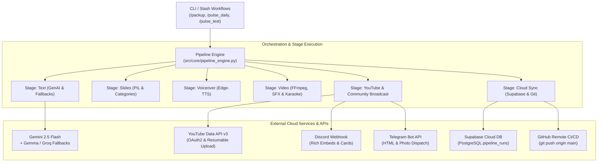
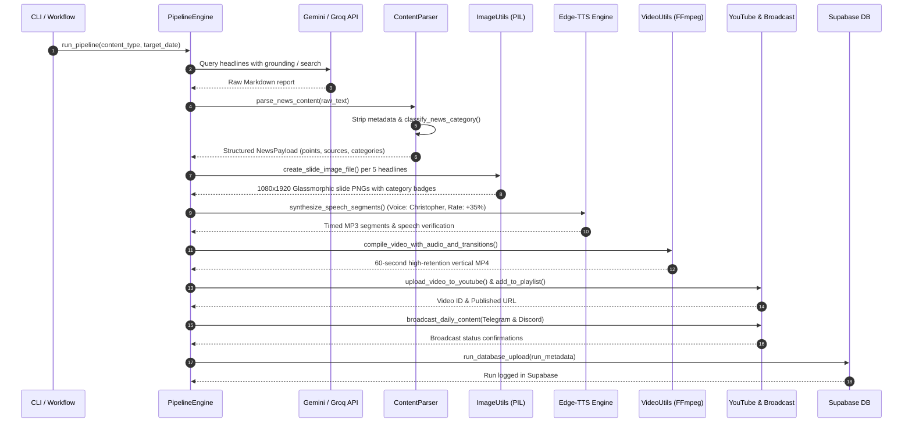
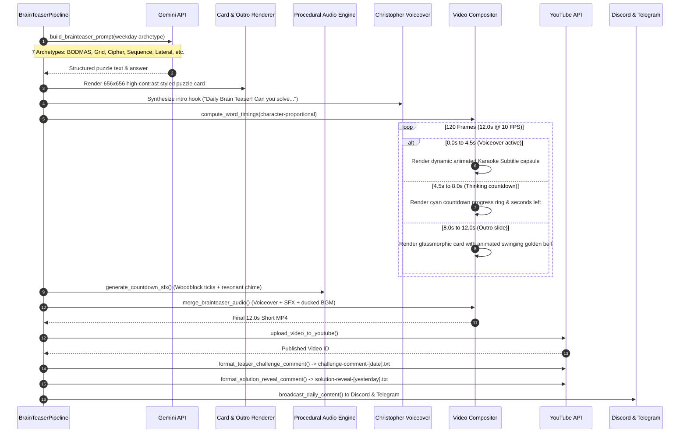

# 🏛️ Pulse Vector — End-to-End System Design & Architecture

**Pulse Vector** is an enterprise-grade, fully autonomous content generation, video rendering, cloud archiving, and multi-platform distribution engine. It autonomously creates daily news intelligence shorts, weekly/monthly masterclasses, and interactive daily brain teasers formatted for vertical short-form platforms (YouTube Shorts, Discord, Telegram).

---

## 1. High-Level Architecture

The system operates across **6 decoupled layers**:
1. **Presentation & CLI Layer**: User interfaces, CLI arguments, and slash workflow triggers.
2. **Pipeline Orchestration Layer**: Pluggable stage execution engine with isolated state management.
3. **Core Processing & Media Engine**: AI content synthesis, category classification, dynamic graphics, neural TTS, procedural SFX, and video rendering.
4. **Distribution & Community Broadcast Layer**: YouTube Data API v3 publishing and real-time Discord/Telegram broadcasting.
5. **Data & Cloud Persistence Layer**: Local structured year/month archive and remote Supabase PostgreSQL metadata logging.
6. **Operations, Health & Diagnostics Layer**: System diagnostic monitors, automated test suites, storage optimizers, and unified packup engine.



---

## 2. Component Architecture & Separation of Concerns

```
pulse-vector/
├── src/
│   ├── pipeline.py                 # Primary CLI entrypoint (daily, weekly, monthly)
│   ├── brainteaser_pipeline.py     # Standalone Brain Teaser generation & publishing engine
│   ├── daily_pipeline.py           # Daily Current Affairs pipeline runner
│   ├── weekly_pipeline.py          # Weekly Masterclass pipeline runner
│   ├── monthly_pipeline.py         # Monthly Masterclass pipeline runner
│   └── core/
│       ├── config.py               # Central environment variables, paths & constants
│       ├── genai_utils.py          # Multi-model LLM generation & fallback routing
│       ├── content_parser.py       # Pure logic parsing, category classification, regex sanitization
│       ├── image_utils.py          # PIL mobile card layout, typography & category badges
│       ├── video_utils.py          # Video compositing, transitions, procedural SFX, karaoke overlay
│       ├── tts_utils.py            # Neural Edge-TTS voiceover synthesis & speech alignment checks
│       ├── youtube_utils.py        # YouTube OAuth authentication, chunked uploads, comment posting
│       ├── database_utils.py       # Supabase PostgreSQL metadata logging & archive sync
│       ├── broadcast_utils.py      # Multi-platform Telegram Bot & Discord Webhook dispatcher
│       └── pipeline_engine.py      # Decoupled stage orchestrator (text, slides, video, upload)
├── scripts/
│   ├── monitor_health.py           # System diagnostic tool (APIs, FFmpeg, OAuth, Supabase)
│   ├── test_pipeline.py            # Offline 20-point automated unit test suite & dry-runs
│   ├── cleanup_workspace.py        # Workspace storage analyzer & safe temporary files purger
│   └── packup_pipeline.py          # Unified master sign-off engine orchestrating all workflows
├── .agent/
│   ├── workflows/                  # Slash workflows (/packup, /pulse_daily, /pulse_clean, etc.)
│   └── skills/                     # Domain skills (content-gen, media-rendering, youtube-dist, etc.)
└── pulse_archive/                  # Partitioned historical storage (YYYY/Month/Type/)
```

---

## 3. Detailed Data Flow Pipelines

### A. Current Affairs Pipeline (Daily, Weekly, Monthly)



---

### B. Daily Brain Teasers Pipeline (Shorts & Community Engagement)



---

## 4. Media & Visual Rendering Subsystem

### 1. Canvas Dimensions & Aspect Ratio
- **Resolution**: `1080 × 1920` pixels (Vertical 9:16 aspect ratio optimized for mobile YouTube Shorts).
- **Background Glow**: Multi-stop radial gradients with Gaussian blurred colour nodes (Cyan `#06b6d4`, Violet `#8b5cf6`, Magenta `#d946ef`, radius: 200).
- **Glassmorphism Spec**: Rounded rectangles with semi-transparent dark fills (`rgba(15, 23, 42, 0.65)`), crisp 1px borders (`rgba(255, 255, 255, 0.14)`), and subtle drop shadows.

### 2. Thematic Category Classifier (`content_parser.py`)
Automatically detects news topic and assigns distinctive editorial colour palettes:

| Category | Accent Color | Hex | Micro-Pill Tag |
| :--- | :--- | :--- | :---: |
| **DEFENCE** | Crimson / Coral | `#f43f5e` | `[DEFENCE]` |
| **ECONOMY** | Amber / Gold | `#f59e0b` | `[ECONOMY]` |
| **TECH & AI** | Electric Cyan | `#06b6d4` | `[TECH & AI]` |
| **GEOPOLITICS** | Deep Violet | `#8b5cf6` | `[GEOPOLITICS]` |
| **ENVIRONMENT** | Emerald Green | `#10b981` | `[ENVIRONMENT]` |
| **NATIONAL** | Royal Blue | `#3b82f6` | `[NATIONAL]` |
| **GLOBAL** | Slate Gray | `#64748b` | `[GLOBAL]` |

### 3. Dynamic Karaoke Subtitle Engine (`video_utils.py`)
- **Timing**: `compute_word_timings()` assigns sub-second character-weighted durations to every spoken word.
- **Visual Grouping**: Words grouped into 3–4 word reading capsules.
- **Active Highlighting**: Current word illuminates in vibrant **electric gold (`#facc15`)**, accompanied by a subtle breathing capsule outline (`rgba(250, 204, 21, 0.4)`).
- **Safety Margins**: Centered vertically at $Y = 1350$, leaving 26px clear margin below the puzzle card and 29px clear margin above the countdown ring.

### 4. Multi-Track Audio Engine (`video_utils.py`)
Video audio is multiplexed across 3 concurrent stereo audio streams:
- **Track 1 (Voiceover)**: Neural TTS (`en-US-ChristopherNeural`) with high-clarity gain.
- **Track 2 (Procedural SFX)**: Mathematically synthesized woodblock clock ticks (800 Hz to 400 Hz exponentially decaying sines) + 523.25 Hz resonant chime.
- **Track 3 (Background Music)**: Ducked ambient royalty-free soundtrack (volume reduced by 75% during voiceover periods).

---

## 5. Multi-Platform Community Distribution Subsystem

### 1. YouTube Distribution
- **Authentication**: OAuth 2.0 with automatic token refresh (`credentials/token.json`).
- **Resumable Chunked Upload**: Resilient against network drops (5MB chunk size).
- **Playlist Routing**: Auto-routes videos into dedicated playlists (`DailyCurrentAffairs`, `WeeklyMasterclass`, `MonthlyMasterclass`, `BrainTeasers`).
- **Safety Quota Management**: Strict daily quota accounting tracked in `Research/youtube_quota_log.md`.

### 2. Discord Webhook Broadcast
- **Protocol**: HTTP POST to `DISCORD_WEBHOOK_URL`.
- **Payload**: Rich Discord Embed with category colour sidebars, puzzle title, formatted option list, and direct YouTube video button.
- **Media Attachment**: High-resolution PNG slide automatically uploaded as a multipart attachment.

### 3. Telegram Bot API Broadcast
- **Protocol**: HTTP POST via `https://api.telegram.org/bot<TOKEN>/sendPhoto`.
- **Formatting**: Rich HTML captions with bold headers, italics, bullet lists, and clickable hyperlinks.
- **Fallback**: Graceful fallback to `sendMessage` if image upload is unavailable.

---

## 6. Fault Tolerance & Graceful Degradation Strategy

| Failure Scenario | Built-in Mitigation & Fallback Strategy |
| :--- | :--- |
| **Gemini 2.5 Rate Limit / Outage** | Automatically falls back to secondary models: `gemini-2.0-flash` $\to$ `gemini-1.5-flash` $\to$ Groq Llama 3.3. |
| **No Internet for Edge-TTS** | Pipeline proceeds with silent visual slides or background music only via `--no-tts` flag. |
| **Missing Discord / Telegram Keys** | `broadcast_daily_content()` catches `None` credentials, logs an informational skip, and returns `False` without crashing. |
| **Audio Track Missing** | Merges video cleanly with procedural SFX only, bypassing background music. |
| **YouTube Token Expired** | Uses OAuth refresh token to renew session silently without user intervention. |

---

## 7. Quality Assurance, Testing & Operations

### 1. Offline Automated Test Suite (`scripts/test_pipeline.py`)
- **Coverage**: 20 modular unit tests spanning regex markdown strippers, news point extractors, BODMAS/Grid/Cipher parsers, slide layout renderers, karaoke subtitle overlays, procedural audio generators, and pipeline dry-runs.
- **Execution Speed**: 20 tests run in under **2.0 seconds** completely offline without burning API quota.

### 2. Unified Master Packup Engine (`scripts/packup_pipeline.py` & `/packup`)
A single slash workflow `/packup` orchestrates 6 sequential phases:
1. `monitor_health.py` (Diagnostics for APIs, FFmpeg, Supabase, OAuth).
2. Asset & Structure Audit (Fonts, 15 audio tracks, archive hierarchy).
3. Test Suite (20 unit tests & dry-runs).
4. Storage Optimizer (Purges temp frames, dangling wavs, and bytecode cache).
5. Domain Skills Audit (Verifies all 6 skills in `.agent/skills/`).
6. Remote Git Synchronization (`git push origin main`).
