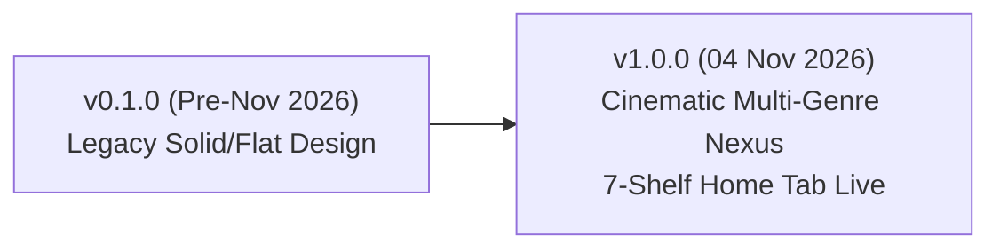

# Pulse Vector — Channel Branding & Visual Asset Ledger

This document tracks all versions, visual assets, YouTube CDN URLs, and metadata snapshots for the Pulse Vector channel branding across all content genres.

---

## 📌 Active Production Release: `v1.0.0`

| Attribute | Details |
| :--- | :--- |
| **Release Codename** | **Cinematic Multi-Genre Nexus** |
| **Release Date** | **04 November 2026 (21:22 IST)** |
| **Deployment Status** | 🟢 **ACTIVE & LIVE ON YOUTUBE** |
| **Live Banner CDN URL** | `https://yt3.googleusercontent.com/2u7xEQWp5YNqus20VGIguSrkJe--MFO3MRDwAORdV8pPAW_2be8hVg8tGAKavHTM4GY7099KfA` |
| **Active Banner Asset** | `channel_branding/assets/banners/banner_cinematic_multigenre_master.png` |
| **Active Profile Icon** | `channel_branding/assets/icons/icon_pulse_vector_3d_master.png` (800x800: `icon_pulse_vector_3d_800.png`) |
| **Archive Folder** | `channel_branding/history/v1.0.0_2026-11-04_cinematic_multigenre/` |
| **Home Tab Architecture** | 7 Optimized High-Retention Shelves Deployed Live |

### Visual Composition & Highlights
- **Banner ($2560 \times 1440$ px, Universal Safe Zone $1546 \times 423$ px)**:
  - **Left**: Ancient Kurukshetra chariot silhouette & glowing celestial arrows at dusk (*Mahabharat*).
  - **Center**: Deep cosmic nebula transition with illuminated 3D digital Earth wireframe.
  - **Right**: Foggy post-apocalyptic survival wasteland with fortified bunker and helicopter (*Last Day on Earth*).
  - **Typography**: 3D metallic title, glowing neon-cyan cardiogram pulse wave, tagline *"WHERE INTELLECT MEETS ACTION"*, and 4 glassmorphic category badges (`CURRENT AFFAIRS`, `BRAIN TEASERS`, `EPIC MAHABHARAT`, `LDoE SURVIVAL`).
- **Profile Icon ($1024 \times 1024$ and $800 \times 800$ px)**:
  - 3D titanium-and-gold geometric 'V' with an emissive neon-cyan cardiogram pulse core on brushed carbon fiber.

---

## 📺 Live Home Tab Shelves Architecture (Active on YouTube)

Configured and synchronized via `channel_branding/setup_hometab_sections.py`:

| Shelf # | Shelf Name | API Type | Target Playlist ID / Feed | Genre / Audience Strategy |
| :---: | :--- | :--- | :--- | :--- |
| **1** | **Daily Current Affairs (Oct - Dec 2026)** | `singleplaylist` | `PLKaPhI3LucGw` | Daily returning UPSC/competitive exam viewers |
| **2** | **Last Day on Earth: Survival — Official Series** | `singleplaylist` | `PLJPzVNVZwaGY` | High-retention 105-episode binge-watch gaming traffic |
| **3** | **Daily Brain Teasers — 2026** | `singleplaylist` | `PLENP5DyB-lS4` | Quick engagement logic puzzles & interactive shorts |
| **4** | **Mahabharat: The Epic Battle of Dharma** | `singleplaylist` | `PLTdRkcKiCRVA` | Cinematic animated historical storytelling (70 episodes) |
| **5** | **Weekly Current Affairs Masterclasses** | `singleplaylist` | `PL4PQLXRi54n0f5deGjKOCuz3VbMOMzmxO` | In-depth retrospectives & weekend educational viewers |
| **6** | **Latest Uploads** | `recentuploads` | Channel Recent Uploads | Dynamic showcase of fresh drops across all pillars |
| **7** | **All Playlists Directory** | `allplaylists` | All Public Playlists | Comprehensive library exploration for channel visitors |

---

## 📜 Historical Version Ledger

### Version History Table

| Version | Date | Status | Banner Asset | Banner CDN URL | Icon Asset | Notes |
| :--- | :--- | :--- | :--- | :--- | :--- | :--- |
| **v1.0.0** | 2026-11-04 | 🟢 **LIVE** | `banner_cinematic_multigenre_master.png` | [YouTube CDN](https://yt3.googleusercontent.com/2u7xEQWp5YNqus20VGIguSrkJe--MFO3MRDwAORdV8pPAW_2be8hVg8tGAKavHTM4GY7099KfA) | `icon_pulse_vector_3d_master.png` | Full photorealistic multi-genre unification across 416+ videos. 7 Home Tab sections live. |
| **v0.1.0** | 2026-10-23 | ⚪ Archived | `mAi7UySB1dEE8Q-s...` | Legacy Google usercontent | Default avatar | Initial setup, flat solid colors, pre-redesign. |

---

## 🔄 Procedure for Timely Future Branding Updates

Whenever creating a new seasonal, event-based, or milestone branding update:

1. **Generate New Graphics**:
   - Save candidate banners in `channel_branding/assets/banners/` (adhering to $2560 \times 1440$ and $1546 \times 423$ safe zone).
   - Save candidate icons in `channel_branding/assets/icons/` (adhering to $1024 \times 1024$ and $800 \times 800$).
2. **Review in Showcase**:
   - Recompile `preview_branding.html` using `python channel_branding/build_branding_showcase.py`.
3. **Deploy via API**:
   - Run `python channel_branding/update_youtube_channel.py --apply --upload-banner`.
   - Update Home Tab sections if needed via `python channel_branding/setup_hometab_sections.py --apply`.
4. **Archive Previous Release**:
   - Archive the old assets into `channel_branding/history/v<version>_<date>_<codename>/`.
   - Update `branding_ledger.json` and `branding_ledger.md` with the new version, date, and live CDN URL.
