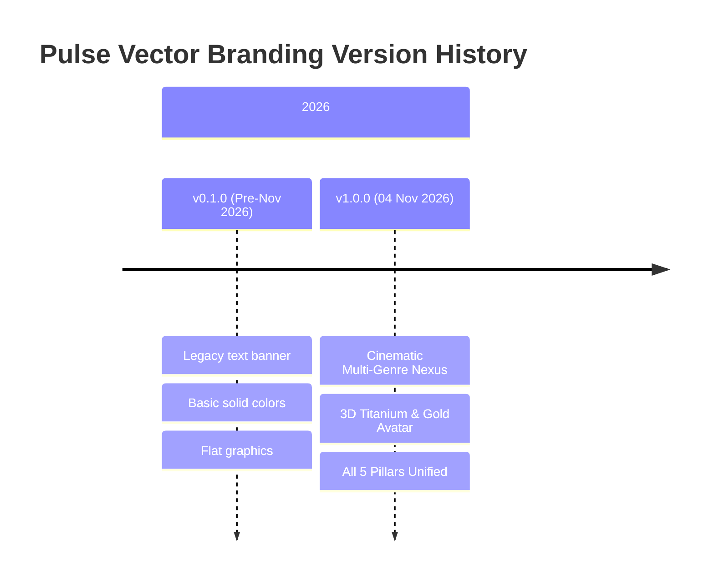

# Pulse Vector — Channel Branding & Visual Asset Ledger

This document tracks all versions, visual assets, YouTube CDN URLs, and metadata snapshots for the Pulse Vector channel branding across all content genres.

---

## 📌 Active Production Release: `v1.0.0`

| Attribute | Details |
| :--- | :--- |
| **Release Codename** | **Cinematic Multi-Genre Nexus** |
| **Release Date** | **04 November 2026 (21:22 IST)** |
| **Deployment Status** | 🟢 **ACTIVE & LIVE ON YOUTUBE** |
| **Live Banner CDN URL** | `https://yt3.googleusercontent.com/2u7xEQWp5YNqus20VGIguSrkJe--MFO3MRDwAORdV8pPAW_2be8hVg8tGAKavHTM4GY7099KfA` |
| **Active Banner Asset** | `channel_branding/assets/banners/banner_cinematic_multigenre_master.png` |
| **Active Profile Icon** | `channel_branding/assets/icons/icon_pulse_vector_3d_master.png` (800x800: `icon_pulse_vector_3d_800.png`) |
| **Archive Folder** | `channel_branding/history/v1.0.0_2026-11-04_cinematic_multigenre/` |

### Visual Composition & Highlights
- **Banner ($2560 \times 1440$ px, Universal Safe Zone $1546 \times 423$ px)**:
  - **Left**: Ancient Kurukshetra chariot silhouette & glowing celestial arrows at dusk (*Mahabharat*).
  - **Center**: Deep cosmic nebula transition with illuminated 3D digital Earth wireframe.
  - **Right**: Foggy post-apocalyptic survival wasteland with fortified bunker and helicopter (*Last Day on Earth*).
  - **Typography**: 3D metallic title, glowing neon-cyan cardiogram pulse wave, tagline *"WHERE INTELLECT MEETS ACTION"*, and 4 glassmorphic category badges (`CURRENT AFFAIRS`, `BRAIN TEASERS`, `EPIC MAHABHARAT`, `LDoE SURVIVAL`).
- **Profile Icon ($1024 \times 1024$ and $800 \times 800$ px)**:
  - 3D titanium-and-gold geometric 'V' with an emissive neon-cyan cardiogram pulse core on brushed carbon fiber.

---

## 📜 Historical Version Ledger

### Version History Table

| Version | Date | Status | Banner Asset | Banner CDN URL | Icon Asset | Notes |
| :--- | :--- | :--- | :--- | :--- | :--- | :--- |
| **v1.0.0** | 2026-11-04 | 🟢 **LIVE** | `banner_cinematic_multigenre_master.png` | [YouTube CDN](https://yt3.googleusercontent.com/2u7xEQWp5YNqus20VGIguSrkJe--MFO3MRDwAORdV8pPAW_2be8hVg8tGAKavHTM4GY7099KfA) | `icon_pulse_vector_3d_master.png` | Full photorealistic multi-genre unification across 416+ videos. Live on YouTube. |
| **v0.1.0** | 2026-10-23 | ⚪ Archived | `mAi7UySB1dEE8Q-s...` | Legacy Google usercontent | Default avatar | Initial setup, flat solid colors, pre-redesign. |

---

## 🔄 Procedure for Timely Future Branding Updates

Whenever creating a new seasonal, event-based, or milestone branding update:

1. **Generate New Graphics**:
   - Save candidate banners in `channel_branding/assets/banners/` (adhering to $2560 \times 1440$ and $1546 \times 423$ safe zone).
   - Save candidate icons in `channel_branding/assets/icons/` (adhering to $1024 \times 1024$ and $800 \times 800$).
2. **Review in Showcase**:
   - Recompile `preview_branding.html` using `python channel_branding/build_branding_showcase.py`.
3. **Deploy via API**:
   - Run `python channel_branding/update_youtube_channel.py --apply --upload-banner`.
4. **Archive Previous Release**:
   - Archive the old assets into `channel_branding/history/v<version>_<date>_<codename>/`.
   - Update `branding_ledger.json` and `branding_ledger.md` with the new version, date, and live CDN URL.
