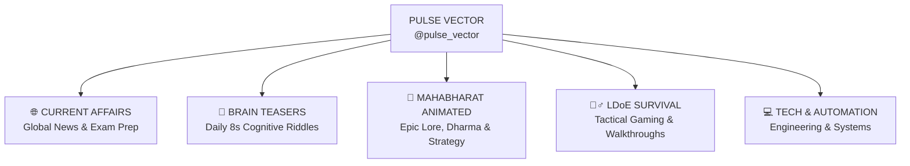

# Pulse Vector — Channel Identity & Branding Specification

> **Branch**: `channel-branding-update`  
> **Channel ID**: `UCt154eXNnEfKtRNBrAnay7A`  
> **Handle**: `@pulse_vector`  
> **Subscribers**: 42+ | **Total Videos**: 416+ | **Lifetime Views**: 16,100+

---

## 🎯 1. Strategic Brand Unification

Pulse Vector represents a unique intersection of **Knowledge, Strategy, Intellect, and Action**. Rather than separating these genres, the new branding establishes **Pulse Vector** as the unified **Nexus of Intellect & Action**:



---

## 📝 2. Updated Channel Metadata

### **Channel Title**
`Pulse Vector`

### **Channel Taglines**
- **Primary**: *Where Intellect Meets Action — Daily Intelligence, Mind Teasers, Epic Lore & Tactical Survival.*
- **Header Line**: *Daily Intelligence • Brain Teasers • Epic Lore • Survival Gaming*

### **Channel Description (About Section)**
*(Strictly optimized for YouTube's 1,000-character limit — 973 chars)*

```text
⚡ Welcome to PULSE VECTOR — The Nexus of Daily Intelligence, Tactical Gaming, Mind Puzzles & Ancient Epics.

Whether preparing for exams, sharpening cognitive agility, exploring epic lore, or mastering survival gaming, Pulse Vector delivers daily.

🔥 CORE PILLARS:
1️⃣ 🌐 CURRENT AFFAIRS: Daily Shorts & Weekly Masterclasses for UPSC, SSC, Banking & Global News.
2️⃣ 🧠 BRAIN TEASERS: 8s logic puzzles, math riddles & aptitude challenges.
3️⃣ 🏹 MAHABHARAT (ANIMATED): 70+ episodes on Kurukshetra, Dharma, Karma & ancient strategy.
4️⃣ 🧟‍♂️ LDoE SURVIVAL: 100+ walkthroughs, Bunker Alfa raids, base building & apocalypse tactics.
5️⃣ 💻 TECH & AUTOMATION: Engineering projects & autonomous systems.

📅 SCHEDULE:
• Daily: Current Affairs & Brain Teaser Shorts
• Weekly: Masterclasses & LDoE Survival Walkthroughs

🤝 COMMUNITY:
• Telegram: https://t.me/pulsevector_daily
• Channel: https://youtube.com/@pulse_vector

🔔 Subscribe to master knowledge, conquer puzzles & stay ahead!
```

### **Channel Keywords / Tags**
*(Formatted for YouTube Data API `brandingSettings.channel.keywords`)*

```text
"Pulse Vector" "Current Affairs" "Daily Current Affairs" "UPSC Current Affairs" "SSC CGL" "Brain Teasers" "Logic Puzzles" "Aptitude" "Mahabharat" "Mahabharat Animation" "Last Day on Earth" LDoE "LDoE Survival" "Bunker Alfa" "Zombie Survival" "Strategy Game" "Tech Stack" "Knowledge Hub"
```

---

## 🎨 3. Visual Identity Specifications

### **A. YouTube Channel Banner Specs**
- **Dimensions**: $2560 \times 1440 \text{ px}$ (16:9 aspect ratio)
- **Safe Area (Mobile + Desktop)**: $1546 \times 423 \text{ px}$ (centered horizontally and vertically: $X = [507, 2053]$, $Y = [508, 931]$)
- **Desktop Full Width**: $2560 \times 423 \text{ px}$
- **TV Canvas**: Full $2560 \times 1440 \text{ px}$

### **B. YouTube Profile Icon / Avatar Specs**
- **Dimensions**: $800 \times 800 \text{ px}$ (rendered at high-fidelity $1024 \times 1024 \text{ px}$ master)
- **Crop**: Circular crop with 10% safety margin from corners.

### **C. Color Palette**
- **Deep Obsidian Navy**: `#0A0E1A` / `#131C31` (Dominant background)
- **Cyber Cyan**: `#00F0FF` (Pulse wave & technical clarity)
- **Radiant Gold / Amber**: `#FFB800` (Ancient epic prestige & energy)
- **Tactical Emerald**: `#10B981` (Survival vitality)
- **Signal Red**: `#EF4444` (YouTube urgency & action)

