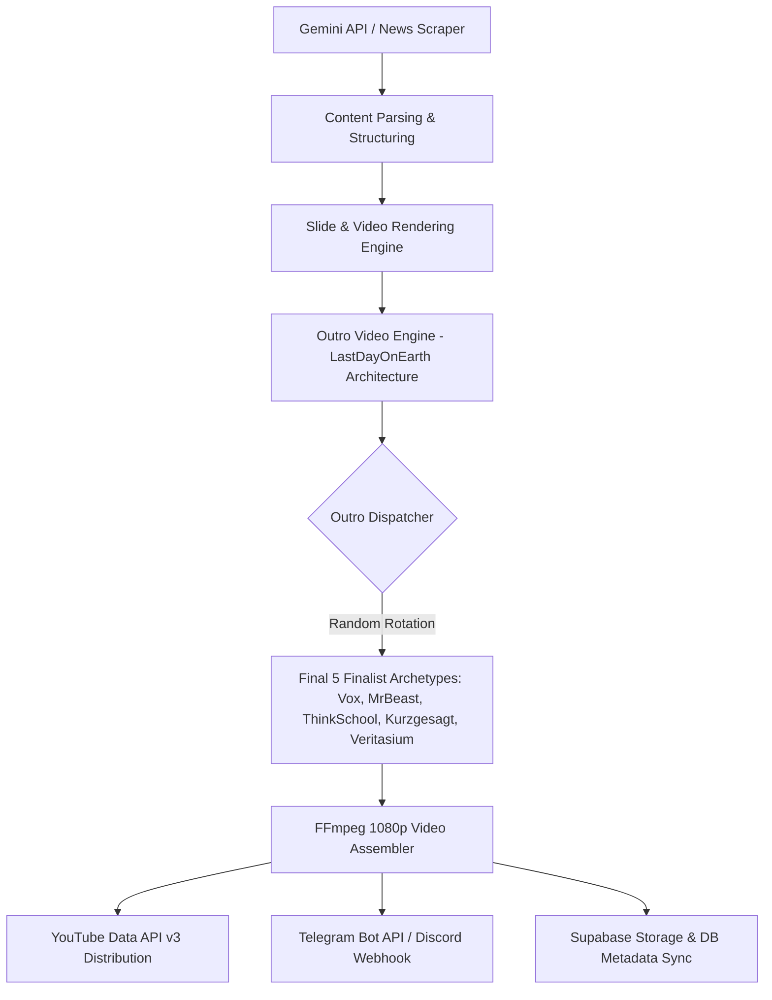

# Pulse Vector — Architecture Specification

## 1. Overview
Pulse Vector is an autonomous pipeline architecture combining AI content generation, automated video compositing, multi-platform broadcast, and cloud archive backups.



## 2. Core Modules

### `src/core/outro_video_engine.py`
Broadcast-quality animated YouTube End Credit Scene Video Generator (7.5-8.5s @ 30fps).
- **Physics**: Mathematical squash-and-stretch button easing (`scale = 1.0 + 0.16 * sin(...)`).
- **Interaction**: Animated Like -> Share -> Subscribe triad with dynamic state transitions.
- **Audio Mixing**: FFmpeg `filter_complex` blending background audio with 1760Hz bell chime SFX.
- **Dynamic Context**: Safe zones for YouTube End Screen elements (640x360), fallback defaults for titles and URLs.
- **Random Outro Rotation**: `get_random_outro_channel()` provides $O(1)$ random archetype rotation.

### `src/core/youtube_utils.py`
- Handles OAuth2 token refresh, video uploads, metadata sanitation (`sanitize_youtube_tags`), quota tracking, and structured playlist descriptions.
- Supports `privacyStatus`: `public`, `unlisted`, `private`.

### `src/core/video_utils.py`
- High-efficiency FFmpeg rendering, slide transitions (`slide_left`, `zoom_fade`, `fade`), audio normalization, and karaoke subtitle overlays.

### `src/core/database_utils.py`
- Supabase PostgreSQL client for backing up media and archiving content metadata.

## 3. Directory Layout
```text
pulse-vector/
├── src/
│   ├── core/                  # Core modules (outro, youtube, video, tts, genai, db)
│   ├── pipeline.py            # CLI entry point
│   └── content_parser.py      # Text processing & news extraction
├── scripts/
│   ├── packup_pipeline.py     # Master sign-off & audit orchestrator
│   ├── test_pipeline.py       # Full automated test suite (63 unit & integration tests)
│   ├── monitor_health.py      # System health diagnostics
│   ├── cleanup_workspace.py   # Temporary frame and cache cleaner
│   ├── build_video_theater.py # Interactive HTML5 video theater generator
│   └── upload_random_outro_test.py # Live video stitching & private upload test
├── fonts/                     # Typography assets (Bangers, Roboto, LuckiestGuy, RussoOne)
├── assets/audio/              # Background music and audio presets
├── samples/End_Credits_Videos/# Rendered outro MP4s and snapshot posters
├── pulse_archive/             # Date-organized publication archive
└── Research/                  # Quota logs, upload records, and developer notes
```

